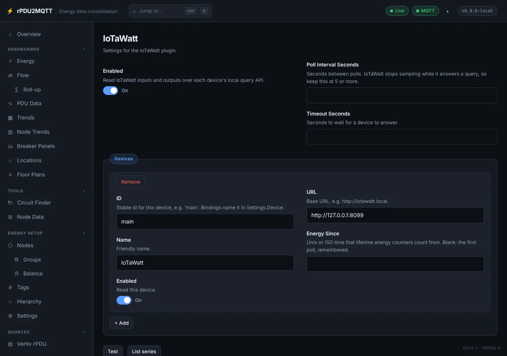
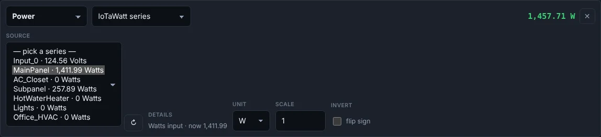
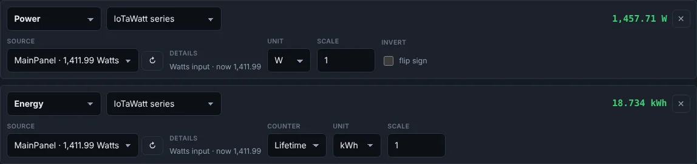

# IoTaWatt

IoTaWatt inputs and outputs read directly over the device's local [query API](https://docs.iotawatt.com/en/master/query.html). No EmonCMS or MQTT in between.

## Add the device

**Sources › IoTaWatt**. Turn on **Enabled**, **+ Add** a device with its ID and URL, **Save**.



| Field | Setting | Default |
| --- | --- | --- |
| Enabled | `Plugins.iotawatt.Enabled` | off |
| Poll Interval Seconds | `PollIntervalSeconds` (5 minimum) | `10` |
| Timeout Seconds | `TimeoutSeconds` | `10` |
| ID | `Devices[].Id` | |
| Name | `Devices[].Name` | |
| URL | `Devices[].Url`, e.g. `http://iotawatt.local` | |
| Energy Since | `Devices[].EnergySince`: unix or ISO time | first poll |
| Enabled | `Devices[].Enabled` | on |

- **Test** reads each device's series list.
- **List series** shows every input and output with its current value.

## Bind a node to a series

**Energy Flow › Nodes**, **Edit** the node, **+ Add binding**.

1. Pick the metric, then **IoTaWatt series** as the type.
2. Pick the series. The list comes from the device, with each series' current value.
3. **Save**. Applies without a restart.



- With more than one device, a device dropdown appears before the series.
- **↻** reads the series list again.
- **Details** shows what the series reads now, or why it can't be read.

## Power and energy on one node

Add two bindings on the same series: **Power** for live watts, **Energy** for kWh.



Energy is IoTaWatt's watt-hours over a range, converted to kWh. No integrator is needed on the IoTaWatt.

| Counter | Reads | Use |
| --- | --- | --- |
| `lifetime` (default) | Wh since **Energy Since**. Blank pins the first poll's time and keeps it across restarts. | Normal choice. The bridge measures its rise. |
| `period` | Wh since the IoTaWatt's local midnight | Today's total, including the hours before the binding was added |

Set **Energy Since** to an earlier date to count from there.

## Metrics

| Series | Metric | Read as |
| --- | --- | --- |
| Power input or output | `realpower` | `.watts` |
| | `apparentpower` | `.va` |
| | `current` | `.amps` |
| | `powerfactor` | `.pf` |
| | `energy` | `.wh`, converted to kWh |
| Voltage input | `voltage` | `.volts` |
| | `frequency` | `.hz` |
| Output in other units | any | its own unit; set **Unit** on the binding |

A series that can't supply the metric (e.g. a voltage input bound as power) is reported on the binding.

## Polling

- One request per device per poll for every bound live series. IoTaWatt does not sample while it answers.
- A value is timed by the 5-second group it was logged in, not by the poll.
- A device that stops answering marks the integration red on **Status**. Its last readings expire after the binding's **Stale after**.

## In YAML

```yaml
Plugins:
  iotawatt:
    Enabled: true
    Devices:
      - { Id: main, Url: http://iotawatt.local }
EnergyFlow:
  Nodes:
    - Id: main_panel
      Label: Main Panel
      Kind: panel
      Sources:
        - { Type: iotawatt, Metric: realpower, Settings: { Series: MainPanel } }
        - { Type: iotawatt, Metric: energy, Settings: { Series: MainPanel } }
    - Id: subpanel
      Label: Subpanel
      Kind: panel
      Sources:
        - { Type: iotawatt, Metric: realpower, Settings: { Series: Subpanel } }
        - { Type: iotawatt, Metric: energy, Accumulation: period, Settings: { Series: Subpanel } }
```

With more than one device, add `Device: <id>` to each binding's `Settings`.
