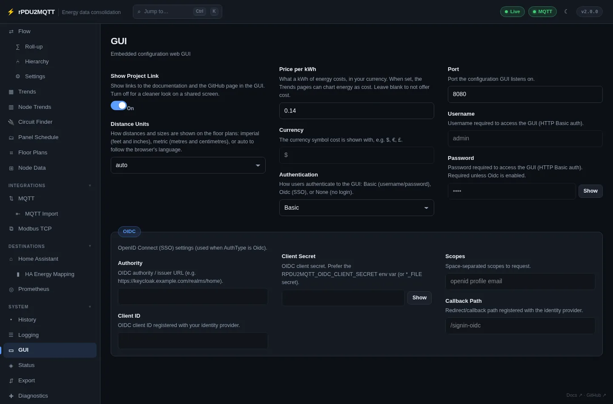
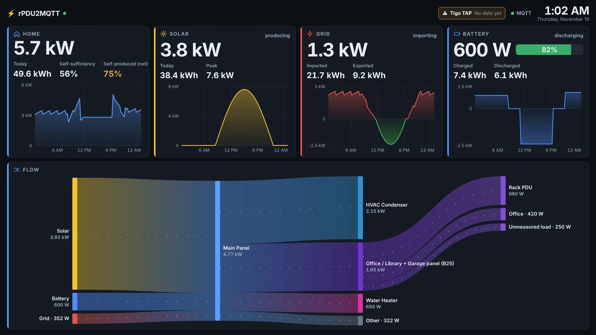

# GUI and authentication

Turn the GUI on with `Gui.Enabled: true` in the config file. Browse to `http://<host>:<port>`.

GUI: **System › GUI**.



| Field | Setting | Default | Notes |
| --- | --- | --- | --- |
| Port | `Gui.Port` | `8080` | Restart to apply |
| Authentication | `Gui.AuthType` | `Basic` | `Basic`, `Oidc`, `None` |
| Username | `Gui.Username` | | Basic |
| Password | `Gui.Password` | | Basic. Or `RPDU2MQTT_GUI_PASSWORD` |
| Trusted networks | `Gui.TrustedNetworks` | empty | Read-only access without signing in. Or `RPDU2MQTT_GUI_TRUSTED_NETWORKS` |
| Trusted proxies | `Gui.TrustedProxies` | empty | Proxies whose `X-Forwarded-For` is read. Or `RPDU2MQTT_GUI_TRUSTED_PROXIES` |
| Show Project Link | `Gui.ShowProjectLink` | on | Docs and GitHub links in the footer |
| Distance Units | `Gui.DistanceUnits` | `auto` | `auto`, `imperial`, `metric`. Floor plans |
| Temperature Units | `Gui.TemperatureUnits` | `auto` | `auto`, `celsius`, `fahrenheit`. Stored values stay °C |
| Price per kWh | `Gui.EnergyPrice` | blank | Enables cost charts on Trends |
| Currency | `Gui.Currency` | `$` | |

## Basic

Username and password over HTTP Basic auth. Use TLS (reverse proxy) outside a trusted network.

## OIDC

Set **Authentication** to `Oidc` and fill the **OIDC** box.

| Field | Setting | Default |
| --- | --- | --- |
| Authority | `Gui.Oidc.Authority` | e.g. `https://keycloak.example.com/realms/home` |
| Client ID | `Gui.Oidc.ClientId` | |
| Client Secret | `Gui.Oidc.ClientSecret` | Or `RPDU2MQTT_OIDC_CLIENT_SECRET` |
| Scopes | `Gui.Oidc.Scopes` | `openid profile email` |
| Callback Path | `Gui.Oidc.CallbackPath` | `/signin-oidc` |

- Register `https://<gui-host>/signin-oidc` as the redirect URI with the provider.
- `X-Forwarded-Proto` and `X-Forwarded-Host` are honoured behind a TLS-terminating proxy.
- A **Log out** link appears in the header.

## Trusted networks

Add an address or CIDR range under **Trusted networks**, e.g. `10.100.64.247/32` for a wall display. Requests from it get the Dashboards pages without signing in.

- Settings, setup, tools and diagnostics pages, saving, and controls are hidden and refused (HTTP 403).
- Credentials are removed from the configuration a trusted viewer receives.
- **Sign in** in the header signs in from a trusted network.
- Empty: everyone signs in. Ignored with `None`.

Behind a reverse proxy, add the proxy's address under **Trusted proxies**. The client address is then read from `X-Forwarded-For`, right to left, while the address that added each entry is a trusted proxy. Without it, every request comes from the proxy.

Behind the Cilium Gateway, the proxy address is the Cilium ingress IP of the node holding the gateway address. List one per node:

```sh
kubectl get ciliumnodes -o custom-columns=NAME:.metadata.name,INGRESS:.spec.ingress
```

Helm values `gui.trustedNetworks` and `gui.trustedProxies` set both lists from the deployment.

## Kiosk

`/kiosk` is a full-screen, read-only view for a wall display, laid out for 1920×1080. No header, navigation or controls. Updates live.



| URL | Theme |
| --- | --- |
| `/kiosk` | Follows the display's system setting |
| `/kiosk?theme=dark` | Dark |
| `/kiosk?theme=light` | Light |

Shows Home, Solar, Grid and Battery now, today's totals, the last 24 hours (with history on), a live Sankey of the flow, and alerts from **Status**. Reloads itself when a new version is deployed.

Add the display's address under **Trusted networks** so it opens without signing in.

## None

No login. Anyone who can reach the port has full access. A warning is logged at startup.

## Saving

- **Save** writes `config.yaml` and keeps the previous file as `config.yaml.bak`.
- A read-only config (ConfigMap, `:ro` mount) disables Save. With the `RpduConfig` custom resource, Save patches the resource. See [Kubernetes CRD](../deployment/kubernetes-crd.md).
- In Docker, mount `config.yaml` without `:ro` and publish the GUI port.
- Host, port and credential changes need a restart (**Diagnostics › Restart**). Name, override and template changes apply with **Republish discovery**.
- Feature switches (`Gui.Enabled`, `HomeAssistant.DiscoveryEnabled`, `Prometheus.Exporter`, `EmonCMS.Enabled`, `History.Enabled`, `Cache.Enabled`, `Api.Enabled`, `Health.Enabled`, `Operator.Enabled`) are set in the config file or chart values, not the GUI. Pages for disabled features are hidden.
- `Health`, `Api`, `PlanStorage` and `Cache` have no GUI page.

## YAML

```yaml
Gui:
  Enabled: true
  Port: 8080
  AuthType: Basic
  Username: admin
  # Password: RPDU2MQTT_GUI_PASSWORD
  EnergyPrice: 0.14
  Currency: "$"
```

```yaml
Gui:
  Enabled: true
  AuthType: Oidc
  Oidc:
    Authority: "https://keycloak.example.com/realms/home"
    ClientId: "rpdu2mqtt"
    Scopes: "openid profile email"
    CallbackPath: "/signin-oidc"
  TrustedNetworks:
    - 10.100.64.247/32
  TrustedProxies:
    - 10.16.3.101/32
```

All settings: [GUI settings reference](../reference/settings/gui.md).
